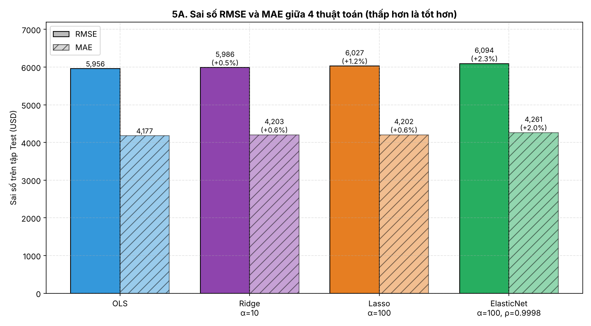
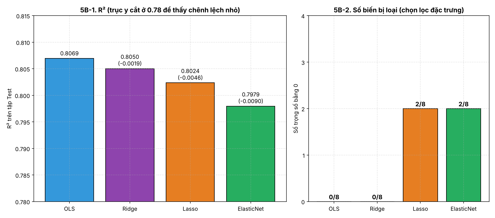
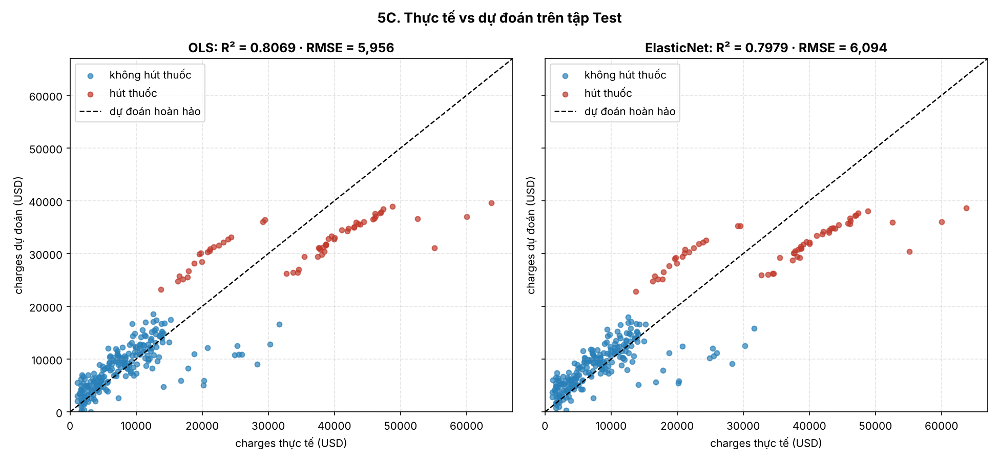
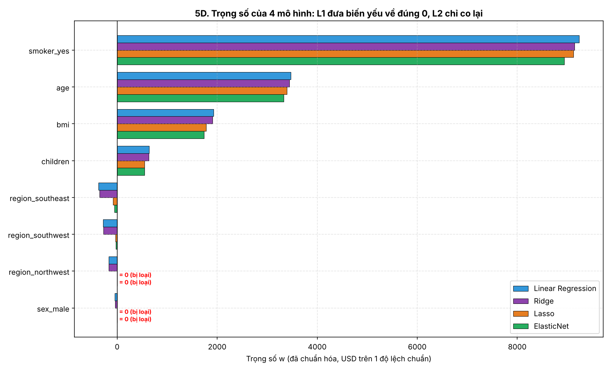
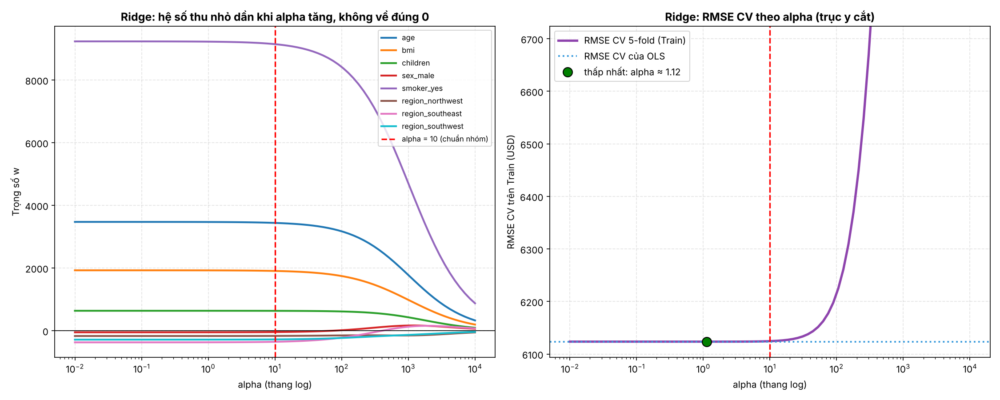
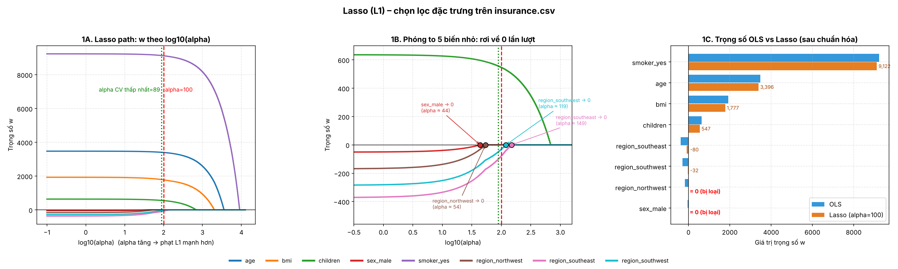
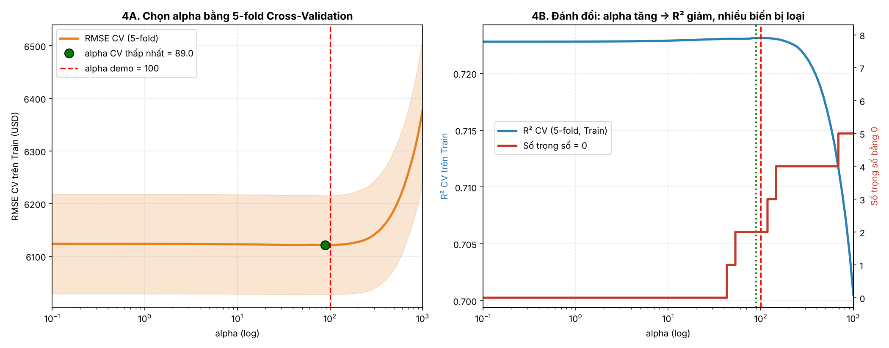

# Kết quả

Tất cả số liệu dưới đây lấy từ lần chạy **Restart Kernel and Run All** gần nhất của Notebook và khớp với các file trong `outputs/`.

## 1. Tập Test (268 dòng) · `outputs/model_results.csv`

| Model | MSE (USD²) | RMSE (USD) | MAE (USD) | R² | Zero weights |
|---|---:|---:|---:|---:|---:|
| Linear Regression (OLS) | 35,478,020.68 | 5,956.34 | 4,177.05 | 0.8069 | 0 |
| Ridge (L2, α = 10) | 35,828,958.09 | 5,985.73 | 4,202.58 | 0.8050 | 0 |
| Lasso (L1, α = 100) | 36,319,178.48 | 6,026.54 | 4,202.30 | 0.8024 | 2 |
| ElasticNet (α = 100, l1_ratio = 0.9998) | 37,130,891.34 | 6,093.51 | 4,261.29 | 0.7979 | 2 |

## 2. 5-fold Cross-Validation trên Train · `outputs/cv_results.csv`

| Model | CV RMSE mean | SD RMSE | CV MAE mean | CV R² mean | SD R² |
|---|---:|---:|---:|---:|---:|
| Linear Regression (OLS) | 6,123.65 | 211.65 | 4,221.96 | 0.7228 | 0.0316 |
| Ridge (L2, α = 10) | 6,124.56 | 210.10 | 4,234.60 | 0.7228 | 0.0306 |
| Lasso (L1, α = 100) | 6,121.25 | 210.01 | 4,209.91 | 0.7231 | 0.0301 |
| ElasticNet (α = 100, l1_ratio = 0.9998) | 6,128.94 | 210.78 | 4,238.23 | 0.7226 | 0.0285 |

**Cách đọc:** chênh lệch giữa các mô hình (khoảng 7.7 USD ở CV RMSE) nhỏ hơn nhiều so với SD giữa các fold (khoảng 210 USD). Vì vậy không thể nói mô hình nào chính xác hơn rõ rệt. R² CV (khoảng 0,723) thấp hơn R² Test (0,798 đến 0,807): điểm Test có thể là kết quả thuận lợi của lần chia này.

## 3. Trọng số $w$ sau `StandardScaler` · `outputs/model_weights.csv`

Đơn vị: USD trên 1 độ lệch chuẩn của biến.

| Đặc trưng | OLS | Ridge | Lasso | ElasticNet |
|---|---:|---:|---:|---:|
| `smoker_yes` | +9,234.34 | +9,145.51 | +9,121.86 | +8,937.99 |
| `age` | +3,472.98 | +3,440.44 | +3,395.69 | +3,327.11 |
| `bmi` | +1,927.83 | +1,907.35 | +1,776.97 | +1,740.35 |
| `children` | +636.50 | +634.44 | +547.36 | +544.33 |
| `region_southeast` | -371.78 | -353.35 | -80.01 | -55.55 |
| `region_southwest` | -284.61 | -277.49 | -31.81 | -29.07 |
| `region_northwest` | -168.94 | -165.80 | +0.00 | +0.00 |
| `sex_male` | -50.75 | -42.92 | +0.00 | +0.00 |

- Lasso và ElasticNet đưa `region_northwest` và `sex_male` về đúng 0.
- `smoker_yes`, `age`, `bmi` có trọng số chuẩn hóa lớn nhất ở cả 4 mô hình. Đây là mối liên hệ thống kê, không phải quan hệ nhân quả.

## 4. Lasso: chọn alpha bằng CV · `outputs/lasso_experiment_logs.csv`, `outputs/lasso_alpha_cv.csv`

| Alpha | CV RMSE (USD) | CV R² | Zero weights | Biến bị loại |
|---:|---:|---:|---:|---|
| 0.1 | 6,123.64 | 0.7228 | 0 | - |
| 1 | 6,123.55 | 0.7228 | 0 | - |
| 10 | 6,122.77 | 0.7229 | 0 | - |
| 25 | 6,121.87 | 0.7230 | 0 | - |
| 50 | 6,121.52 | 0.7230 | 1 | sex_male |
| 89.02 | 6,121.19 | 0.7231 | 2 | sex_male, region_northwest |
| 100 | 6,121.25 | 0.7231 | 2 | sex_male, region_northwest |
| 118 | 6,121.81 | 0.7231 | 2 | sex_male, region_northwest |
| 150 | 6,123.21 | 0.7230 | 4 | sex_male, region_northwest, region_southeast, region_southwest |
| 200 | 6,127.14 | 0.7227 | 4 | sex_male, region_northwest, region_southeast, region_southwest |
| 500 | 6,190.55 | 0.7173 | 4 | sex_male, region_northwest, region_southeast, region_southwest |
| 1000 | 6,377.58 | 0.7005 | 5 | children, sex_male, region_northwest, region_southeast, region_southwest |

- CV RMSE thấp nhất trong lưới 100 giá trị: alpha ≈ **89.02**, CV RMSE **6,121.19 USD**.
- Alpha demo 100: CV RMSE **6,121.25 USD**, cao hơn **0.06 USD**. Cả hai cùng loại đúng 2 biến.
- Từ alpha 10 đến 150, CV RMSE chênh nhau khoảng 2 USD, trong khi SD giữa các fold khoảng 210 USD: đường CV rất phẳng. Không gọi alpha 100 là tối ưu tuyệt đối.

## 5. Ridge: chọn alpha bằng CV · `outputs/ridge_alpha_cv.csv`

CV RMSE thấp nhất ở alpha ≈ 1.12 (6,123.64 USD); alpha = 10 cho 6,124.56 USD; OLS cho 6,123.65 USD. Chênh dưới 1 USD, vì VIF thấp (lớn nhất 1,68) nên OLS không bị đa cộng tuyến nặng.

## 6. ElasticNet: ảnh hưởng của `l1_ratio` (alpha = 100) · `outputs/elasticnet_l1_ratio_cv.csv`

| l1_ratio | CV RMSE (USD) | CV R² | Zero weights |
|---:|---:|---:|---:|
| 0.05 | 11,600.20 | 0.0126 | 0 |
| 0.1 | 11,595.43 | 0.0135 | 0 |
| 0.25 | 11,577.35 | 0.0165 | 0 |
| 0.5 | 11,523.68 | 0.0256 | 0 |
| 0.75 | 11,367.52 | 0.0519 | 0 |
| 0.9 | 10,938.93 | 0.1221 | 0 |
| 0.99 | 7,960.69 | 0.5350 | 0 |
| 0.9998 | 6,128.94 | 0.7226 | 2 |
| 1 | 6,121.25 | 0.7231 | 2 |

`l1_ratio` hạ xuống 0,99 là R² CV đã tụt mạnh vì phần L2 đủ lớn ép mọi trọng số về gần 0. Cấu hình `0.9998` gần Lasso, không phải cân bằng L1/L2.

## 7. Biểu đồ (14 hình trong `docs/images/`)

| Hình | File |
|---|---|
| 5A. RMSE và MAE 4 mô hình | `5A_rmse_mae_comparison.png` |
| 5B. R² và số trọng số bị loại | `5B_r2_zero_weights.png` |
| 5C. Thực tế vs dự đoán | `5C_true_vs_predicted.png` |
| 5D. Trọng số 4 mô hình | `5D_weights_comparison.png` |
| 4.1 OLS đơn biến | `4.1_ols_univariate.png` |
| 4.1 OLS phần dư | `4.1_ols_residuals.png` |
| 4.2 Ridge: coefficient path và RMSE CV | `4.2_ridge_coefficient_path.png` |
| Lasso Hình 1: path, phóng to, OLS vs Lasso | `3_lasso_l1_feature_selection.png` |
| Lasso Hình 2: hình thoi L1 vs hình tròn L2 (minh họa 2 trọng số) | `3_lasso_geometry_l1_vs_l2.png` |
| Lasso Hình 3: đạo hàm và soft-thresholding | `3_lasso_soft_threshold_derivative.png` |
| Lasso Hình 4: chọn alpha bằng CV | `3_lasso_alpha_tuning.png` |
| 4.4 ElasticNet: tác động `l1_ratio` | `4.4_elasticnet_l1_ratio.png` |
| 4.4 ElasticNet: coefficient path | `4.4_elasticnet_path.png` |
| 4.4 ElasticNet: ổn định nhóm biến (**mô phỏng**, không phải `insurance.csv`) | `4.4_elasticnet_group_stability.png` |

